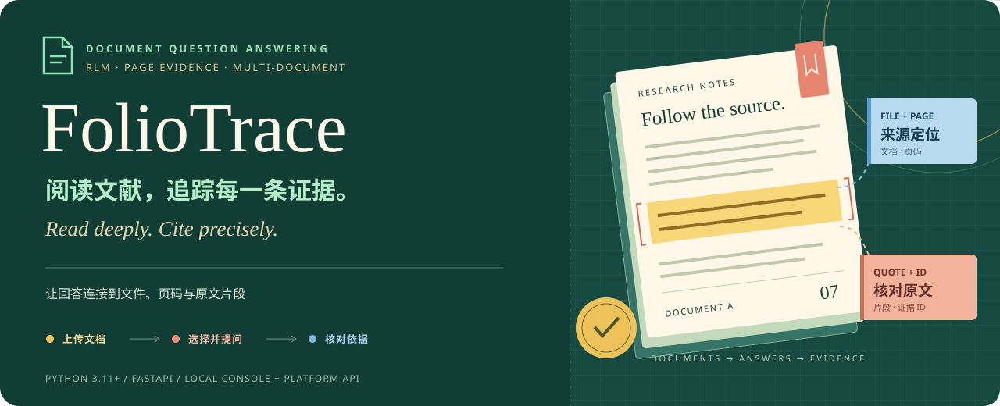
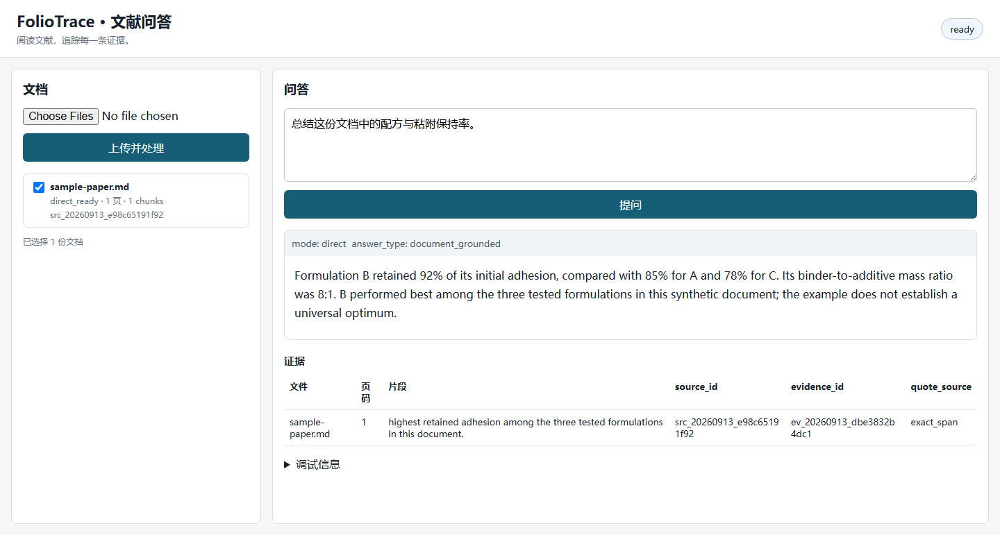
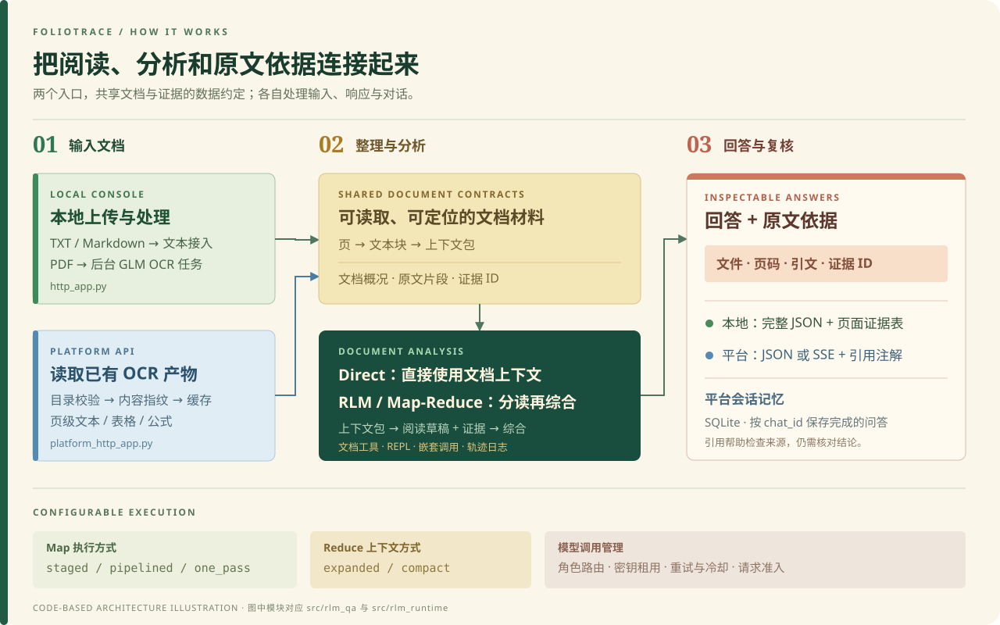

<p align="center">
  
</p>

<p align="center">
  <strong>上传文档 → 跨文档提问 → 回到原文核对依据</strong><br>
  面向论文与技术文档的问答应用，支持多文档分析、页级证据和平台流式接口。
</p>

<p align="center">
  <a href="#quick-start">快速开始</a> · <a href="#console">界面预览</a> ·
  <a href="#architecture">工作原理</a> · <a href="#platform-api">平台 API</a> ·
  <a href="#project-map">代码导航</a> · <a href="docs/usage.md">配置文档</a>
</p>

FolioTrace 帮你把“读到一个回答”和“找到它的依据”连在一起。比如，选中几篇材料论文，询问“各文档报告了哪些配方？对应的结果是什么？”，再通过回答附带的**文件名、页码和原文片段**检查来源。

封面是项目概念插画；下方控制台图展示仓库已有的实际界面。

## 可以用它做什么

| 你要完成的事 | 项目提供的能力 |
| --- | --- |
| 读一份论文或技术说明 | 上传 PDF、TXT、Markdown，查看文档处理状态 |
| 对比多份资料 | 选择多个文档，按文档规模使用直接上下文或多文档分析 |
| 查回答的出处 | 查看文件、页码、引文、`source_id` 与 `evidence_id` |
| 接入已有文档平台 | 读取页级 OCR 产物，返回 JSON 或 SSE 流式回答与引用注解 |
| 在同一组资料上继续追问 | 平台入口通过 `metadata.chat_id` 复用 SQLite 会话记忆 |
| 管理模型调用 | 分开配置生成、Map 子模型与 OCR 角色，使用密钥池、重试、冷却和请求准入 |

**RLM（Recursive Language Models，递归语言模型）**在这里指让模型借助 Python 交互执行环境读取文档、调用工具，并按需继续调用子模型的分析方式。项目自带 `rlm_runtime`，不需要另外安装上游的 `rlms` 包。

<a id="console"></a>

## 本地控制台预览



**仓库保留的实际界面截图，内容来自离线演示。** 左侧是已选中的虚构样本 `sample-paper.md`，右侧依次显示问题、固定回答和证据表。截图中的回答与 [`examples/offline_demo.py`](examples/offline_demo.py) 的固定文案一致；它展示界面和证据呈现方式，不代表在线模型或 OCR 的效果。

使用时可以顺着这条路线操作：**上传并处理 → 勾选文档 → 输入问题 → 在证据表中核对文件、页码和片段**。TXT 与 Markdown 的页码由程序划分，是“虚拟页”，并非 PDF 印刷页码。

<a id="quick-start"></a>

## 快速开始

需要 **Python 3.11+**。先获取仓库，然后在仓库根目录安装：

```bash
git clone https://github.com/Nathan10969/folio-trace.git
cd folio-trace
python -m venv .venv
source .venv/bin/activate
python -m pip install -e '.[dev]'
cp .env.example .env
```

这些命令依次获取项目、进入目录、创建独立 Python 环境、启用它、安装项目及开发依赖、复制配置模板。Windows PowerShell 对应的启用和复制命令是：

```powershell
.\.venv\Scripts\Activate.ps1
Copy-Item .env.example .env
```

### 第一步：不填密钥，先体验界面

```bash
python examples/offline_demo.py
```

打开 **http://127.0.0.1:8787**，上传 [`examples/sample-paper.md`](examples/sample-paper.md)，勾选它，然后输入：

```text
Summarize this document and compare retained adhesion.
```

离线演示会返回一段固定样例回答，用于体验上传、存储和证据渲染。它不调用外部模型，也没有配置 PDF OCR；这一阶段请使用随仓库提供的 Markdown 样本。

### 第二步：配置自己的模型服务

在本地编辑 `.env`，按照实际需要配置以下角色：

| 角色 | 配置项 | 用途 |
| --- | --- | --- |
| 主生成 | `GLM_GENERATION_API_KEYS`、`GLM_GENERATION_MODEL` | 生成与综合回答 |
| 生成回退 | `DEEPSEEK_API_KEY`、`DEEPSEEK_MODEL` | 主生成路径不可用时的回退 |
| Map 子模型 | `DEEPSEEK_SUBAGENT_API_KEYS`、`DEEPSEEK_SUBAGENT_MODEL` | 分别阅读文档上下文包 |
| PDF OCR | `GLM_OCR_API_KEYS` 或 `GLM_OCR_API_KEY`、`GLM_OCR_MODEL` | 从 PDF 中提取文本 |

密钥池支持用逗号分隔多个密钥。模型名称请填写你的服务账号实际支持的值；模板中的名称来自源码快照。环境变量与当前工作目录的 `.env` 均可配置，非空环境变量优先。

先停止离线演示，再启动本地应用：

```bash
python -m uvicorn rlm_qa.http_app:app --host 127.0.0.1 --port 8787
```

仍然打开 **http://127.0.0.1:8787**。先上传 TXT 或 Markdown 可以跳过 OCR；处理 PDF 时需要配置 OCR 角色。在线推理会将文档内容和问题发送给配置的模型服务，运行产物则保存在本地目录。完整路由、执行模式和存储配置见[使用文档](docs/usage.md)。

<a id="architecture"></a>

## 从文档到可核对的回答



上图按现有模块绘制，是架构示意图。两个入口共享文档与证据的数据约定，但各自负责不同的输入和交付方式：

| | 本地控制台 | 平台 API |
| --- | --- | --- |
| Python 入口 | `rlm_qa.http_app:app` | `rlm_qa.platform_http_app:app` |
| 接收什么 | 上传的 PDF、TXT、Markdown | 已存在的 OCR 文档目录 |
| PDF 如何处理 | 后台 GLM OCR 任务 | 上游已经完成 OCR |
| 如何返回回答 | 完整 JSON；页面显示答案与证据表 | JSON 或 SSE（逐段发送内容）及引用注解 |
| 如何保存对话 | 运行产物记录 `session_id` | 按 `chat_id` 保存 SQLite 会话历史 |

应用先把内容整理为**页、文本块、文档概况和证据 ID**。较小的文档选择可以直接进入模型上下文；较大的选择使用 RLM 与 Map-Reduce。Map-Reduce 是“先分开读，再合起来答”：Map 阶段阅读上下文包、收集草稿及允许引用的证据，Reduce 阶段综合结果。

Map 支持 `staged`、`pipelined`、`one_pass`，Reduce 支持 `expanded`、`compact`。默认配置为 `staged` 与 `expanded`；`one_pass` 的初次结果不完整时可以触发深读修复。运行时还提供交互执行、嵌套模型调用、调用限制和轨迹日志。

引用用于帮助你检查答案依据。当前本地 Direct 路径仍有关键词匹配门槛，部分具体问题可能回退到不含文档引用的通用模型回答；`Summarize this document` 这类总览问题使用完整文档上下文。平台入口则使用独立的模型驱动文档检查约定。

### 模型能够调用哪些文档工具

工具定义位于 [`src/rlm_qa/document_tools.py`](src/rlm_qa/document_tools.py)：

| 工具 | 做什么 |
| --- | --- |
| `list_packs` / `read_packs` | 查看上下文包目录，再读取指定包的全文 |
| `read_pages` / `read_chunks` | 读取指定页或文本块 |
| `lookup_evidence` | 根据证据 ID 查找引文及文件信息 |
| `expand_evidence` | 读取证据所在文本块的更多上下文 |
| `search_context` | 用关键词缩小范围或找回引用线索 |

<a id="platform-api"></a>

## 平台流式 API

已有 OCR 产物时，启动独立的平台入口：

```bash
python -m uvicorn rlm_qa.platform_http_app:app --host 127.0.0.1 --port 8788
```

在 `RLM_PLATFORM_DATA_ROOT` 下准备文档目录。每份文档包含 `status.json`、`metadata.json`，以及带页码的 `elements.jsonl` 或回退文件 `text_blocks.jsonl`。字段示例见[平台文档格式约定](docs/usage.md#platform-document-contract)。平台入口读取这些产物，不负责上传 PDF 或执行 OCR。

以下命令以已准备好的 `paper-a` 与 `paper-b` 为例：

```bash
curl -N http://127.0.0.1:8788/v1/chat/completions \
  -H 'Content-Type: application/json' \
  -d '{
    "model": "precise",
    "messages": [{"role": "user", "content": "Compare the reported formulations."}],
    "metadata": {
      "chat_id": "literature-review-01",
      "dir_names": ["paper-a", "paper-b"],
      "doc_ids": ["101", "102"]
    },
    "stream": true
  }'
```

`dir_names` 指定根目录下的文档子目录；提供 `doc_ids` 时，它必须与目录一一对应。沿用同一个 `chat_id` 可以继续会话。`model` 是客户端模式标签，实际服务商模型由服务器配置；标准 OpenAI 风格客户端也需要补充这里的 `metadata`。

流式响应包含答案增量与引用注解，客户端需保留注解才能把行内标记对应到文件和页码。完成的问答会写入会话记忆，取消的部分回答不会写入。本地 `/chat` 只返回完整 JSON，不能通过 `stream` 字段启用 SSE。

| 常用端点 | 用途 |
| --- | --- |
| 本地 `POST /upload` | 以 multipart 表单的 `file` 字段上传文档 |
| 本地 `GET /documents/{source_id}` | 查询处理状态 |
| 本地 `POST /chat` | 对已上传的文档提问 |
| 平台 `POST /chat` 或 `/v1/chat/completions` | 对已处理文档提问，可启用 SSE |
| 两个入口的 `GET /healthz` | 检查进程健康 |
| 平台 `GET /readyz` | 检查配置与运行目录是否就绪，不发起真实模型调用 |

<a id="project-map"></a>

## 代码与文档导航

| 从哪里读起 | 内容 |
| --- | --- |
| [`src/rlm_qa/http_app.py`](src/rlm_qa/http_app.py) · [`platform_http_app.py`](src/rlm_qa/platform_http_app.py) | 两个 FastAPI 入口与请求格式 |
| [`app_service.py`](src/rlm_qa/app_service.py) · [`platform_service.py`](src/rlm_qa/platform_service.py) | 上传、文档问答与平台服务编排 |
| [`document_map_reduce.py`](src/rlm_qa/document_map_reduce.py) · [`map_scheduler.py`](src/rlm_qa/map_scheduler.py) | 多文档分析、分包调度与结果综合 |
| [`document_tools.py`](src/rlm_qa/document_tools.py) · [`evidence_quotes.py`](src/rlm_qa/evidence_quotes.py) | 文档读取工具、证据与引文处理 |
| [`llm.py`](src/rlm_qa/llm.py) · [`config.py`](src/rlm_qa/config.py) · [`key_pool.py`](src/rlm_qa/key_pool.py) | 模型角色路由、配置和密钥池 |
| [`src/rlm_runtime/`](src/rlm_runtime/) | REPL 交互执行、嵌套调用、工具注册与轨迹日志 |
| [`web/static/`](web/static/) | 本地上传和问答页面 |
| [`tests/`](tests/) · [`examples/`](examples/) | 测试、虚构样本和固定离线演示 |
| [`docs/usage.md`](docs/usage.md) | API、环境变量、文档格式和运行目录 |
| [`docs/performance.md`](docs/performance.md) · [`docs/provenance.md`](docs/provenance.md) | 历史性能记录与源码来源说明 |
| [`deploy/folio-trace.service`](deploy/folio-trace.service) | 平台 API 的 systemd 部署模板 |

FolioTrace 是项目名和发行包名；Python 导入名 `rlm_qa`、`rlm_runtime`、原有接口名及 RLM 环境变量保留兼容。仓库来自源码快照，来源与历史记录的范围见[来源说明](docs/provenance.md)。

## 检查与运行边界

开发依赖安装后，可以运行：

```bash
python -m pytest tests -q -ra
python -m build
```

现有测试涵盖上传与问答接口、OCR 任务生命周期、文档缓存、模型路由、Map-Reduce、引用处理、取消请求和会话记忆；JavaScript 测试需要 **Node.js 20+**。仓库的 [CI 配置](.github/workflows/ci.yml) 使用 Linux 与 Python 3.11 / 3.12。

测试使用固定样本与模拟服务验证工程行为。已有的环境与性能记录见[历史性能文档](docs/performance.md)，其中列有运行条件与适用范围。

REPL 在应用进程中执行生成的 Python，使用受限内建函数，但没有独立的执行隔离。HTTP 接口没有内置用户认证；本地使用请绑定回环地址，对外部署需要认证网关与执行隔离。回答中的引用也仍需人工核对。

## 背景与许可

[Recursive Language Models 项目](https://github.com/alexzhang13/rlm) 介绍了 REPL 与递归模型调用的基本思路。FolioTrace 将其用于文档问答，并在当前快照中包含运行时实现。

[MIT License](LICENSE) · Copyright © 2026 Nathan10969。上游致谢与许可文本见[第三方说明](THIRD_PARTY_NOTICES.md)。
